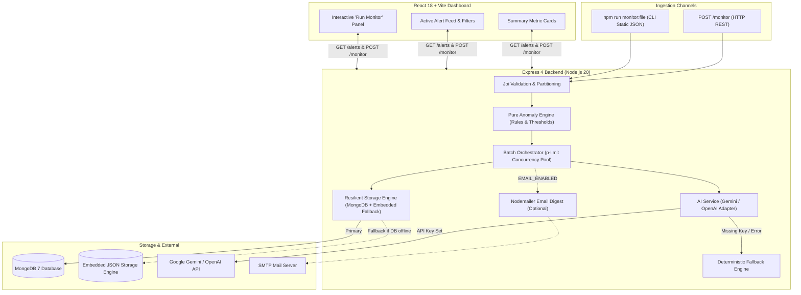

# Intelligent API Monitoring & Alert System

An automated API health monitoring and intelligent anomaly detection system for a healthcare company integrating with external patient and clinical services. The system evaluates response metrics, detects multi-dimensional performance and availability anomalies, generates concise human-readable alerts using LLMs with deterministic zero-key fallbacks, persists anomalies in MongoDB (with automatic resilient embedded storage fallback), and displays active incidents on a real-time React dashboard.

---

## 1. Project Overview & Architecture

### 1.1 Problem Scenario
Healthcare integrations with external EHR, appointment, and lab systems frequently encounter transient degradation—such as high response times, partial outages (HTTP 5xx/4xx), or empty datasets (missing/zero records). This system provides proactive anomaly detection and operator-focused AI explanations without alert fatigue.

### 1.2 System Architecture



---

## 2. Prerequisites

- **Node.js**: `v20.x` or higher (LTS recommended)
- **MongoDB**: `v7.x` or higher running locally or via MongoDB Atlas *(Optional: If MongoDB is offline, an automatic embedded persistent JSON store activates seamlessly)*
- **Package Manager**: `npm` (v10+)
- **LLM API Key**: Google Gemini API key *(Optional: If omitted, zero-key deterministic fallback generates human-readable alerts instantly)*

---

## 3. Quick Start & Setup

### 3.1 Clone & Repository Structure
```bash
git clone <repository-url>
cd "Intelligent API Monitoring & Alert System"
```

### 3.2 Environment Configuration
Copy the provided environment template to `.env` (at root or in `backend/.env`):
```bash
cp .env.example .env
```

Configure your preferred settings in `.env`:
```env
PORT=5001
MONGO_URI=mongodb://localhost:27017/api_monitor
LLM_PROVIDER=gemini
LLM_MODEL=gemini-3.5-flash-lite
LLM_API_KEY=your_gemini_api_key_here  # Leave blank to test deterministic fallback
```

### 3.3 Install Dependencies
```bash
# Install root, backend, and frontend packages
npm install --prefix backend
npm install --prefix frontend
```

### 3.4 Launch Application

**Option A: Run From Root (Convenience Scripts)**
```bash
# Terminal 1: Start Backend (Port 5001)
npm run start:backend

# Terminal 2: Start Frontend (Port 3000)
npm run start:frontend
```

**Option B: Run Individually**
```bash
# Backend (Express API on Port 5001)
cd backend && npm run dev

# Frontend (Vite Dev Server on Port 3000)
cd frontend && npm run dev
```

* Backend runs at `http://localhost:5001` (with automatic port collision fallback if 5000 is occupied by macOS AirPlay).
* Frontend runs at `http://localhost:3000` with reverse proxy to `http://localhost:5001`.
* Database: Connects to MongoDB when available; automatically activates embedded persistent storage if MongoDB is offline.

---

## 4. Environment Variables Reference

| Variable | Type | Default | Description |
|---|---|---|---|
| `PORT` | Number | `5001` | Port for Express backend (auto-falls back to 5001 if 5000 is occupied). |
| `NODE_ENV` | String | `development` | Runtime environment (`development`, `production`, `test`). |
| `MONGO_URI` | String | `mongodb://localhost:27017/api_monitor` | MongoDB connection string. |
| `SLOW_THRESHOLD_MS` | Number | `3000` | Latency exceeding this triggers a `medium` severity alert. |
| `VERY_SLOW_THRESHOLD_MS` | Number | `5000` | Latency exceeding this triggers a `high` severity alert. |
| `LLM_PROVIDER` | String | `gemini` | AI provider adapter (`gemini` or `openai`). |
| `LLM_API_KEY` | String | `""` | Provider API key. When blank, system seamlessly uses deterministic fallbacks. |
| `LLM_MODEL` | String | `gemini-3.5-flash-lite` | LLM model identifier (`gemini-3.5-flash-lite`, `gpt-4o-mini`). |
| `LLM_TIMEOUT_MS` | Number | `10000` | Max timeout for AI generation before triggering fallback (10s). |
| `LLM_CONCURRENCY` | Number | `5` | Maximum concurrent LLM requests via `p-limit`. |
| `EMAIL_ENABLED` | Boolean | `false` | Master toggle for email digest reports on critical/high alerts. |
| `SMTP_HOST` | String | `""` | SMTP mail server hostname. |
| `SMTP_PORT` | Number | `587` | SMTP port (e.g. 587 for TLS, 465 for SSL). |
| `SMTP_USER` | String | `""` | SMTP authentication user. |
| `SMTP_PASS` | String | `""` | SMTP authentication password (never logged). |
| `SMTP_FROM` | String | `alerts@api-monitor.local` | Sender email address. |
| `ALERT_RECIPIENT_EMAIL` | String | `""` | Recipient email address for operational alerts. |

---

## 5. Anomaly Detection Rules & Severity Hierarchy

The pure rules engine (`backend/src/services/anomalyService.js`) independently evaluates each response metric against three criteria. A single response can trigger multiple anomalies simultaneously.

| Anomaly Type | Condition | Severity | Description |
|---|---|---|---|
| `SERVER_ERROR` | HTTP status `500` to `599` | `critical` | Upstream service failure or unhandled exception. |
| `HIGH_RESPONSE_TIME` | `response_time_ms > 5000` | `high` | Severe latency violation requiring immediate investigation. |
| `ZERO_RECORDS` | `records_returned` is `0`, `null`, or omitted | `high` | Missing or zero records returned from an active endpoint. |
| `CLIENT_ERROR` | HTTP status `400` to `499` | `medium` | Bad request, authentication rejection, or route not found. |
| `HIGH_RESPONSE_TIME` | `response_time_ms > 3000` and `≤ 5000` | `medium` | Warning latency degradation. |

### Severity Resolution: Highest-Severity-Wins
When multiple anomalies occur simultaneously, the top-level severity resolves to the highest priority:
$$\text{critical} > \text{high} > \text{medium}$$
*Example:* `AppointmentAPI` with HTTP 500 (`critical`), 5500 ms latency (`high`), and 0 records (`high`) resolves to **`critical`**, while preserving all three triggered tags in `anomalyTypes`.

---

## 6. Ingestion Methods

### Method 1: HTTP REST API (`POST /monitor`)
Ingest batches of monitored API telemetry via HTTP:

```bash
curl -X POST http://localhost:5001/monitor \
  -H "Content-Type: application/json" \
  -d '[
    {
      "api_name": "PatientDataAPI",
      "response_time_ms": 1200,
      "status_code": 200,
      "records_returned": 50
    },
    {
      "api_name": "AppointmentAPI",
      "response_time_ms": 5500,
      "status_code": 500,
      "records_returned": 0
    }
  ]'
```

**Response (`200 OK`):**
```json
{
  "success": true,
  "summary": {
    "processed": 2,
    "healthy": 1,
    "anomaliesDetected": 1,
    "alertsCreated": 1,
    "invalidItems": 0,
    "failures": 0,
    "durationMs": 1158
  },
  "alerts": [
    {
      "id": "7586ed77301e5fb0d4af7837",
      "apiName": "AppointmentAPI",
      "severity": "critical",
      "anomalyTypes": ["HIGH_RESPONSE_TIME", "SERVER_ERROR", "ZERO_RECORDS"],
      "metrics": {
        "responseTimeMs": 5500,
        "statusCode": 500,
        "recordsReturned": 0
      },
      "message": "AppointmentAPI returned status 500 with a response time of 5500 ms and 0 records, indicating severely impaired performance. Likely service outage.",
      "messageSource": "ai",
      "status": "active"
    }
  ]
}
```

### Method 2: CLI Static JSON File Runner (`npm run monitor:file`)
Pass static JSON datasets through the exact same ingestion and AI pipeline used by `POST /monitor`:

```bash
# From repository root
npm run monitor:file

# Or with a custom file path
node backend/scripts/runFromFile.js /path/to/custom-data.json
```

---

## 7. Active Alerts API (`GET /alerts`)

Retrieve active operational anomalies sorted by `createdAt: -1`:

```bash
# Fetch all active alerts
curl http://localhost:5001/alerts

# Filter by severity
curl "http://localhost:5001/alerts?severity=critical"

# Filter by API name
curl "http://localhost:5001/alerts?apiName=AppointmentAPI"

# Pagination
curl "http://localhost:5001/alerts?limit=10&page=1"
```

---

## 8. Optional Email Notifications Setup

To receive email digests when new `critical` or `high` severity anomalies occur:

1. Configure SMTP parameters in `.env`:
   ```env
   EMAIL_ENABLED=true
   SMTP_HOST=smtp.gmail.com
   SMTP_PORT=587
   SMTP_USER=your-email@gmail.com
   SMTP_PASS=your-app-password
   ALERT_RECIPIENT_EMAIL=oncall-team@healthcare.org
   ```
2. Any batch containing high/critical severity anomalies will dispatch an HTML digest table.
3. Email delivery errors are logged to Winston and **never** block or fail the HTTP response.

---

## 9. Verification & Automated Testing

### 9.1 Running Automated Test Suite (42 Tests)
```bash
# Run from repository root
npm test

# Or run directly from backend
cd backend && npm test
```

The test suite consists of 3 comprehensive suites validating all system requirements:
- **`api.test.js`**: Full integration suite covering `POST /monitor`, `GET /alerts`, status filters, search sanitization, malformed payload partitioning, 404 handler, and health checks.
- **`anomalyService.test.js`**: Pure rules engine unit tests validating latency boundaries, HTTP status classifications, missing/zero record detection, and severity escalation hierarchy.
- **`fallbackMessages.test.js`**: Deterministic fallback engine tests verifying grammatical accuracy and clarity across all possible combinations of anomalies without LLM dependencies.

### 9.2 Verification Checklist & Edge Cases
| Scenario | Command / Action | Expected Result |
|---|---|---|
| **Empty Array** | `curl -X POST http://localhost:5001/monitor -H "Content-Type: application/json" -d '[]'` | `400 Bad Request` (`VALIDATION_ERROR`) |
| **Non-Array Body** | `curl -X POST http://localhost:5001/monitor -H "Content-Type: application/json" -d '{}'` | `400 Bad Request` (`VALIDATION_ERROR`) |
| **Malformed Item Partitioning** | Submit 1 valid item + 1 invalid item (`api_name: ""`) | `200 OK`, valid item saved, `invalidItems: 1` |
| **Zero-Key Fallback** | Unset `LLM_API_KEY` in `.env` and submit batch | `200 OK`, `messageSource: "fallback"`, <50ms response |
| **Database Disconnect** | Stop local MongoDB daemon | `200 OK`, auto-switches to embedded persistent storage |

---

## 10. Frontend Dashboard Features

- **Header**: Live backend health status, auto-refresh countdown (every 10s), manual refresh trigger.
- **Summary Cards**: Click-to-filter stat cards for Total, Critical, High, and Medium anomalies with full keyboard accessibility (`Enter`/`Space`).
- **Filter Controls**: Severity filter pills, real-time API name search, and reset filter capabilities.
- **Alert Cards**: Color-coded severity badges, relative timestamps, raw telemetry pills (status, latency, records), and AI (`✨ AI Alert`) vs. Fallback badges.
- **Run Monitor Panel**: Built-in test sandbox to submit JSON arrays directly to `POST /monitor` in the browser with sample presets and syntax validation.
